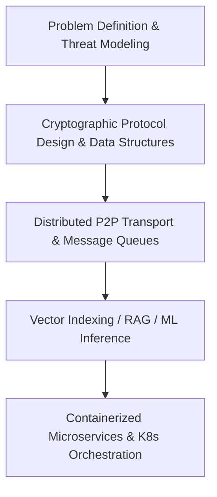

  <!-- Waving Gradient Header Banner -->
  

   

  <!-- Dynamic Typing SVG -->
  

    

  <!-- Badges & Social Links -->
  
  
  
  

 

---

## ⚡ 01 // SYSTEM_OVERVIEW

I'm a **4th-year Computer Science Engineering student at R.V. College of Engineering**, Bengaluru, focused on building distributed systems, cryptographic storage, and retrieval-augmented AI architectures.

* 🛠️ **Engineering Focus:** Distributed Fault Tolerance, Post-Quantum Security, High-Throughput Event-Driven Pipelines, and Context-Aware RAG.
* 🧩 **Algorithmic Rigor:** 300+ DSA problems solved across LeetCode, GeeksforGeeks, and CodeStudio.
* 🎯 **Goal:** Open to Software Engineering, Backend Infrastructure, Distributed Systems, and AI/ML Engineering roles.

---

## 🛠️ 02 // TECH_MATRIX

  

 

<b>Detailed Tech Breakdown</b>

 

* **Languages:** `C++`, `C`, `Python`, `Go`, `Java`, `JavaScript`, `TypeScript`
* **Systems & Infra:** `Docker`, `Kubernetes`, `RabbitMQ`, `Linux`, `Git`, `TCP/IP Networking`
* **Backend Frameworks:** `Django REST`, `FastAPI`, `Node.js`, `Express.js`, `Flask`
* **Databases & Storage:** `PostgreSQL (pgvector)`, `MongoDB (GridFS)`, `Redis`, `Supabase (RLS)`
* **AI & Machine Learning:** `TensorFlow`, `Scikit-Learn`, `NetworkX (Graph Mining)`, `Isolation Forest`, `RAG Pipelines`

---

## 📐 03 // ARCHITECTURE & ENGINEERING METHODOLOGY

---

## 🚀 04 // FEATURED_PROJECTS

<b>🗄️ Distributed-pqc-storage — Post-Quantum Fault-Tolerant Storage Fabric</b>

 

> **Tech:** `Go` | `Docker` | `TCP/IP` | `ML-KEM-768` | `Reed-Solomon` | `AES-GCM`

* Engineered a **5-node distributed P2P storage system** with custom TCP transport achieving **40% fault tolerance** (2-of-5 node failures) via Reed-Solomon (3+2) erasure coding at 1.67× storage overhead.
* Integrated **ML-KEM-768 post-quantum handshakes**, SHA-256 content-addressable deduplication, and an autonomous self-healing audit engine with gossip metadata sync.
* 🔗 [GitHub Repository](https://github.com/suhasshetti02/distributed-pqc-storage)

<b>🎬 Distributed-media-pipeline — Event-Driven Async Video Processing</b>

 

> **Tech:** `Python` | `RabbitMQ` | `Docker` | `Kubernetes` | `MongoDB GridFS`

* Built a **4-service event-driven microservices pipeline** on Kubernetes, decoupling CPU-bound video-to-audio conversion via RabbitMQ.
* Guaranteed durable message delivery with manual ACK/NACK requeuing, chunked large-file streaming with MongoDB GridFS, and stateless JWT validation across all services.
* 🔗 [GitHub Repository](https://github.com/suhasshetti02/distributed-media-pipeline)

<b>📄 ContextDrop — Document-Grounded AI Platform (RAG)</b>

 

> **Tech:** `Python` | `Django` | `Node.js` | `PostgreSQL (pgvector)` | `Redis`

* Developed a multi-format document Q&A platform using structure-aware chunking and `pgvector` similarity search.
* Implemented Django REST and Node.js microservices communicating via internal APIs with Redis rate limiting and Server-Sent Events (SSE) for real-time LLM response streaming.
* 🔗 [GitHub Repository](https://github.com/suhasshetti02/ContextDrop)

<b>🔐 Aegis-Gate — Context-Aware Network Access Control</b>

 

> **Tech:** `Python` | `Flask` | `RSA-2048` | `Isolation Forest`

* Built a zero-trust network access prototype with device fingerprinting, RSA-2048 challenge-response, and dynamic risk scoring.
* Leveraged Isolation Forest anomaly detection to identify untrusted logins based on device risk and behavior patterns.
* 🔗 [GitHub Repository](https://github.com/suhasshetti02/Aegis-gate)

<b>🧬 Cross-Language Semantic Code Clone Detector</b>

 

> **Tech:** `Python` | `FastAPI` | `NetworkX` | `LLVM IR` | `React`

* Designed a compiler-oriented code clone detector evaluating semantic similarity across C, C++, Rust, and Fortran.
* Built control/data-flow graph representations from LLVM IR with Weisfeiler-Lehman graph hashing for structural fingerprinting.
* 🔗 [GitHub Repository](https://github.com/suhasshetti02/cross-language-semantic-code-clone-detector)

---

## 🧩 05 // PROBLEM_SOLVING & ALGORITHMIC_MASTERY

  

 

- **Core Strengths:** Arrays, Two Pointers, Sliding Window, Trees, Graphs (BFS/DFS, Dijkstra), Dynamic Programming, Greedy, Backtracking, and Advanced Data Structures.
- **Platforms:** Active solver on **LeetCode**, **GeeksforGeeks**, and **CodeStudio**.

---

## 📊 06 // GITHUB_ANALYTICS & ACTIVITY_GRAPH

  <!-- Dynamic Contribution Activity Graph -->
  

 

  
  

 

  
  

 

---

  

