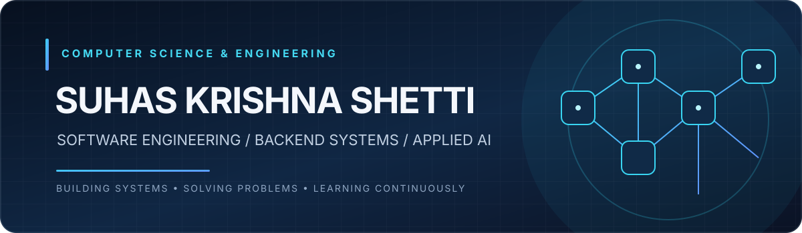
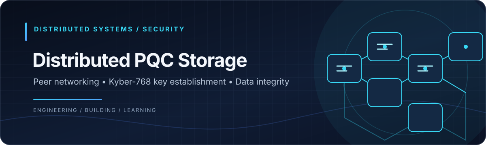
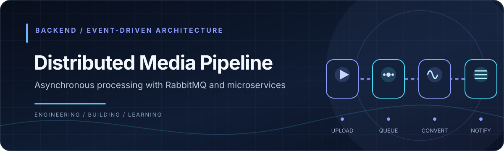
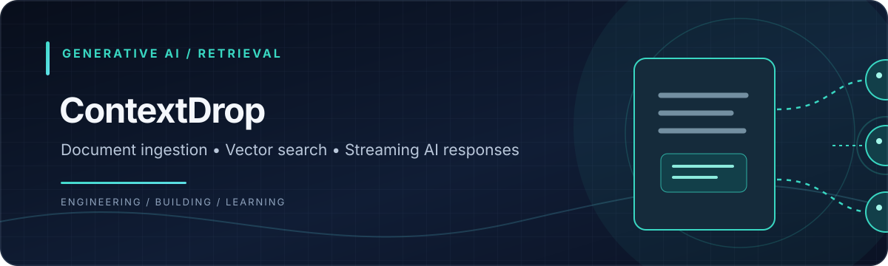
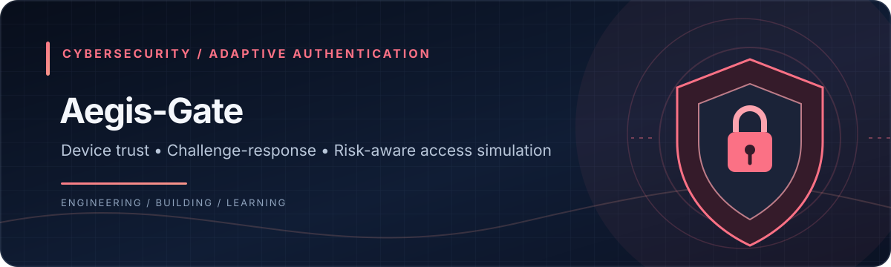
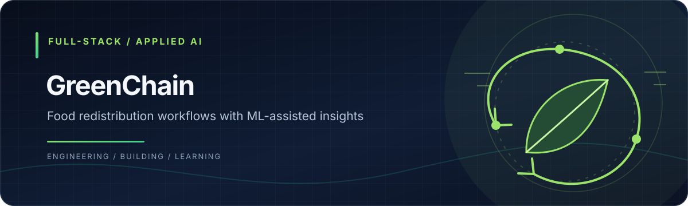
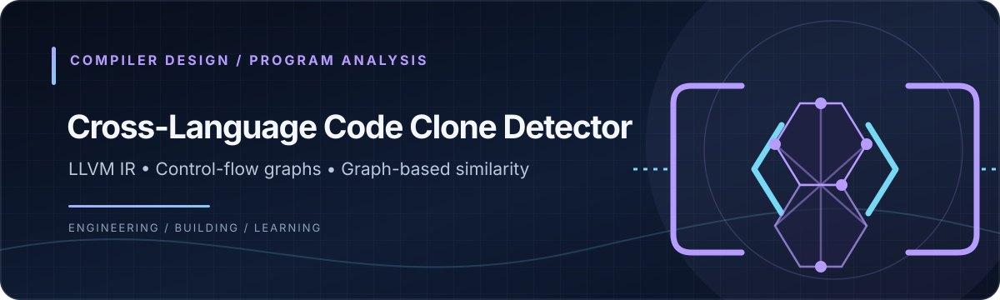

  

    

  
  
  
  

---

## 01 — ABOUT ME
WHO I AM · WHAT I BUILD · WHAT I EXPLORE

I'm **Suhas Krishna Shetti**, a Computer Science and Engineering student at **R.V. College of Engineering, Bengaluru**.

I enjoy building software beyond conventional CRUD applications — from backend services and distributed workflows to cryptography and document-grounded AI applications.

**Current interests:** Software engineering, backend architecture, distributed systems, applied AI, and problem solving.

**Open to:** Software Engineering and Backend Engineering opportunities.

---

## 02 — TECHNICAL TOOLKIT
LANGUAGES · FRAMEWORKS · INFRASTRUCTURE

**Languages**

**Backend & Frontend**

**Data & Infrastructure**

**AI / ML & Tools**

<strong>Technology details</strong>

| Area | Technologies |
|---|---|
| Languages | C, C++, Python, Go, Java, JavaScript, TypeScript |
| Backend | Node.js, Express, Django REST, FastAPI, Flask |
| Frontend | React, Next.js, React Native, Tailwind CSS |
| Databases | PostgreSQL, Supabase, MongoDB, Firebase, Redis |
| Distributed Systems | RabbitMQ, TCP/IP, Microservices, Event-Driven Architecture |
| Cloud & DevOps | Docker, Kubernetes, AWS, Linux |
| AI / ML | TensorFlow, scikit-learn, Hugging Face, RAG, NLP |
| Security | RSA, AES-GCM, JWT, PBKDF2 |

---

## 03 — SELECTED PROJECTS
SYSTEMS BUILT · IDEAS IMPLEMENTED · PROBLEMS SOLVED

A selection of systems and prototypes I've been building across backend engineering, distributed computing, security, and applied AI.

### 01. Distributed PQC Storage

A Go-based distributed-storage prototype exploring peer-to-peer file transfer, cryptographic key establishment, and data recovery.

- Custom TCP peer communication and local storage nodes.
- Kyber-768-based key establishment with AES-GCM encryption.
- SHA-256 content addressing and Reed-Solomon erasure-coding components.
- SQLite metadata with shard audit and recovery workflows.

**Stack:** Go · TCP/IP · Kyber-768 · AES-GCM · Reed-Solomon · SQLite

[View repository →](https://github.com/suhasshetti02/Distributed-pqc-storage)

---

### 02. Distributed Media Processing Pipeline

An event-driven microservices prototype for asynchronous video-to-audio processing.

- Four services: Authentication, Gateway, Converter, and Notification.
- RabbitMQ decouples upload requests from background conversion jobs.
- MongoDB GridFS stores source media and generated audio.
- JWT-based gateway authentication and message acknowledgements.

**Stack:** Python · Flask · RabbitMQ · MongoDB GridFS · Docker · Kubernetes

[View repository →](https://github.com/suhasshetti02/Distributed-media-pipeline)

---

### 03. ContextDrop — Document-Grounded AI

A document intelligence platform that turns uploaded documents and web content into contextual question-answering experiences.

- Document ingestion, text extraction, and structure-aware chunking.
- Embeddings and PostgreSQL pgvector similarity search for retrieval.
- Separate Django REST and Node.js/Express services.
- Server-Sent Events (SSE) for streaming responses.
- Redis-backed rate limiting and HMAC-based internal service authentication.

**Stack:** Python · Django REST · Node.js · PostgreSQL · pgvector · Redis

[View repository →](https://github.com/suhasshetti02/ContextDrop)

---

### 04. Aegis-Gate — Context-Aware Access Control

A context-aware authentication and network-access simulation prototype that evaluates user credentials, device identity, and access risk.

- PBKDF2-based password handling, device fingerprinting, and email OTP.
- RSA-PSS challenge-response with one-time nonce validation.
- Rule-based risk scoring and per-user Isolation Forest anomaly detection when enough history is available.
- Simulated IP allocation and role-based VLAN assignment.

**Stack:** Python · Flask · RSA-PSS · PBKDF2 · Isolation Forest · SQLite

[View repository →](https://github.com/suhasshetti02/Agis-gate)

---

### 05. GreenChain — Food Redistribution Platform

A full-stack platform connecting food donors with NGOs and receivers through donation and claim-management workflows.

- Donation discovery, creation, and claim-management flows.
- Supabase PostgreSQL and Storage for application data and media.
- Separate FastAPI machine-learning service for spoilage-risk estimation.
- Gemini-assisted food-safety guidance with fallback logic.
- JWT-based authentication and messaging integrations.

**Stack:** Next.js · Node.js · Express · Supabase PostgreSQL · FastAPI · Gemini

[View repository →](https://github.com/suhasshetti02/greenchain-platform)

---

### 06. Cross-Language Code Clone Detector

A compiler-oriented prototype exploring structural similarity between programs written in C, C++, Rust, and Fortran.

- Compiler pipelines that can generate LLVM Intermediate Representation (IR).
- Control Flow Graph (CFG) and Data Flow Graph (DFG) construction.
- Weisfeiler-Lehman graph hashing and structural program features.
- Pairwise and multi-file comparison interface.

**Stack:** Python · FastAPI · LLVM IR · NetworkX · React

[View repository →](https://github.com/suhasshetti02/cross-lang-code-detector)

---

<strong>More projects & experiments</strong>

| Project | Focus | Repository |
|---|---|---|
| Plant Pulse | Random Forest crop recommendation and CNN-based plant-disease classification | [Source](https://github.com/suhasshetti02/Plant-Pulse) |
| TruthLab | Multimodal fake-news analysis using MuRIL, Vision Transformer, and cross-modal learning | [Source](https://github.com/suhasshetti02/explainable-multimodal-fakenews-detection) |
| SolarShare | IoT-based energy-sharing prototype using React Native, Firebase, and ESP32 | [Source](https://github.com/suhasshetti02/solarshare-app) |
| Flight Route Optimization | Route algorithms and interactive weather-aware visualisation | [Source](https://github.com/suhasshetti02/Fligh_Route_Optimization_System) |
| Bio-Mat Web | Biodegradable-material catalogue using React, Express, and MongoDB | [Source](https://github.com/suhasshetti02/bio-mat-web) |

---

## 04 — ENGINEERING APPROACH
HOW I DESIGN · BUILD · INTEGRATE · DELIVER

I focus on understanding how software components fit together — from data structures and protocols to service boundaries, retrieval pipelines, testing, and deployment.

---

## 05 — DATA STRUCTURES & ALGORITHMS
PROBLEM SOLVING · ALGORITHMIC THINKING · CORE CS

I practise problem solving to strengthen algorithmic thinking and core computer-science fundamentals.

**Topics:** Arrays · Strings · Hashing · Two Pointers · Sliding Window · Binary Search · Trees · Graphs · Greedy · Dynamic Programming · Backtracking

[Visit my LeetCode profile →](https://leetcode.com/u/suhasshetti02/)

---

## 06 — GITHUB CONTRIBUTIONS
OPEN-SOURCE WORK · CONSISTENCY · CONTRIBUTION HISTORY

  <h3>👾 Contribution Maze</h3>

  <picture>
    <source
      media="(prefers-color-scheme: dark)"
      srcset="https://raw.githubusercontent.com/suhasshetti02/suhasshetti02/output/pacman-contribution-graph-dark.svg"
    />
    <source
      media="(prefers-color-scheme: light)"
      srcset="https://raw.githubusercontent.com/suhasshetti02/suhasshetti02/output/pacman-contribution-graph.svg"
    />
    
  </picture>

    

  

---

## 07 — LET'S CONNECT
COLLABORATION · IDEAS · ENGINEERING OPPORTUNITIES

**Interested in building useful software and solving challenging engineering problems.**

  

Designed with a focus on clarity, systems thinking, and continuous learning.

