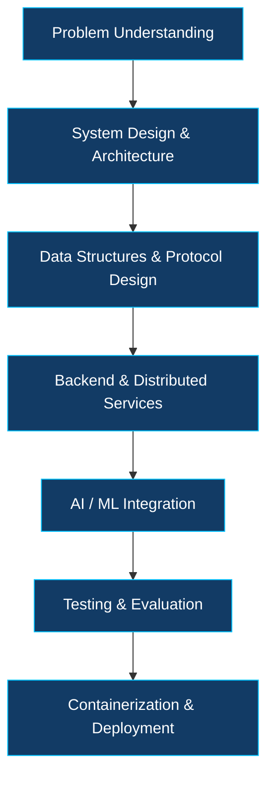

  <!-- Animated Header -->
  

   

  <!-- Typing Animation -->
  

    

  <!-- Social Links -->
  
  
  
  

 

---

## 01 // ABOUT ME

Hi! I'm **Suhas Krishna Shetti**, a Computer Science and Engineering student at **R.V. College of Engineering, Bengaluru**.

I enjoy building systems that go beyond conventional CRUD applications, particularly in backend engineering, distributed computing, cryptography, and applied AI.

My engineering interests include:

- ⚙️ Backend Engineering and Distributed Systems
- 🔐 Cryptography and Post-Quantum Security
- 🤖 Generative AI, RAG and Intelligent Applications
- 🧠 Data Structures, Algorithms and Problem Solving
- ☁️ Cloud Infrastructure and Microservices

**Currently focused on:** Building reliable backend systems, understanding distributed architectures, and developing practical AI-powered applications.

**Looking for:** Software Engineering, Backend Engineering, Distributed Systems and AI Engineering opportunities.

 

---

## 02 // TECHNOLOGY STACK

  <h3>Languages & Development</h3>

  

  <h3>Backend, Databases & Infrastructure</h3>

  

  <h3>AI, ML & Developer Tools</h3>

  

<b>Detailed Technology Breakdown</b>

| Category | Technologies |
|---|---|
| Languages | C++, C, Python, Go, Java, JavaScript, TypeScript |
| Backend | Node.js, Express.js, Django REST, FastAPI, Flask |
| Databases | PostgreSQL, Supabase, MongoDB, Firebase, Redis |
| Distributed Systems | RabbitMQ, TCP/IP, Microservices, Event-Driven Architecture |
| Cloud & DevOps | Docker, Kubernetes, AWS, Linux |
| AI / ML | TensorFlow, Scikit-learn, Hugging Face, RAG, NLP |
| Security | RSA, AES-GCM, JWT, PBKDF2, Cryptographic Protocols |
| Tools | Git, GitHub, Postman, VS Code |

---

## 03 // ENGINEERING APPROACH

I approach software development through system design, modularity, and measurable implementation.

My focus is not only implementing features, but also understanding how systems communicate, manage data, handle failures, and scale.

---

## 04 // FEATURED PROJECTS

### 🗄️ 1. Distributed PQC Storage System

Distributed Systems | Cryptography | Fault Tolerance

**Tech:** `Go` `TCP/IP` `Kyber-768` `AES-GCM` `Reed-Solomon` `SQLite`

A distributed storage prototype exploring secure peer-to-peer communication and data availability.

- Developed custom TCP-based peer communication and file-storage components.
- Integrated Kyber-768-based key establishment and AES-GCM encryption.
- Implemented SHA-256 content addressing and Reed-Solomon erasure-coding components.
- Built SQLite-backed metadata management and shard audit/recovery workflows.

**Engineering focus:** Peer communication, cryptographic key establishment, data integrity, and recovery mechanisms.

🔗 [View Repository](https://github.com/suhasshetti02/Distributed-pqc-storage)

---

### 🎬 2. Distributed Media Processing Pipeline

Microservices | Event-Driven Architecture | Asynchronous Processing

**Tech:** `Python` `Flask` `RabbitMQ` `MongoDB GridFS` `Docker` `Kubernetes`

An asynchronous video-to-audio processing system built around independent microservices.

- Designed four services: Authentication, Gateway, Converter, and Notification.
- Used RabbitMQ to decouple upload requests from background conversion jobs.
- Integrated MongoDB GridFS for video and generated audio storage.
- Implemented JWT-based authentication and manual message acknowledgements.

**Engineering focus:** Service communication, message queues, asynchronous workloads, and media processing.

🔗 [View Repository](https://github.com/suhasshetti02/Distributed-media-pipeline)

---

### 📄 3. ContextDrop — Document-Grounded AI Platform

Generative AI | Retrieval-Augmented Generation | Backend Engineering

**Tech:** `Python` `Django REST` `Node.js` `PostgreSQL` `pgvector` `Redis`

A document intelligence platform that transforms uploaded documents and web content into shareable question-answering experiences.

- Implemented document ingestion, text extraction, and structure-aware chunking.
- Integrated embeddings and PostgreSQL pgvector similarity search for contextual retrieval.
- Developed independent Django REST and Node.js/Express services.
- Implemented Server-Sent Events (SSE) for streaming AI responses.
- Added Redis-backed rate limiting and HMAC-based internal service authentication.

**Engineering focus:** RAG pipelines, vector search, inter-service communication, and grounded AI responses.

🔗 [View Repository](https://github.com/suhasshetti02/ContextDrop)

---

### 🔐 4. Aegis-Gate — Context-Aware Network Access Control

Cybersecurity | Cryptography | Adaptive Authentication

**Tech:** `Python` `Flask` `RSA-2048` `PBKDF2` `Isolation Forest` `SQLite`

A context-aware authentication prototype that evaluates both user credentials and device trust.

- Implemented password authentication using PBKDF2-SHA256.
- Integrated device fingerprinting, trusted-device registration, and email OTP verification.
- Developed RSA-PSS challenge-response authentication and one-time nonce validation.
- Combined rule-based risk assessment with per-user Isolation Forest anomaly detection.
- Implemented simulated IP allocation and role-based VLAN assignment.

**Engineering focus:** Authentication protocols, device trust, risk evaluation, and access-control simulation.

🔗 [View Repository](https://github.com/suhasshetti02/Agis-gate)

---

### 🌱 5. GreenChain — Food Redistribution Platform

Full-Stack Engineering | Applied AI | Cloud Applications

**Tech:** `Next.js` `Node.js` `Express` `Supabase PostgreSQL` `FastAPI` `Gemini`

A food redistribution platform connecting donors with NGOs and receivers through donation and claiming workflows.

- Developed donation creation, discovery, and claim-management workflows.
- Integrated Supabase PostgreSQL and Storage for application data and images.
- Built a separate FastAPI machine-learning service for spoilage-risk / priority estimation.
- Integrated Gemini-assisted food-safety guidance with rule-based fallback logic.
- Implemented JWT-based authentication and messaging integrations.

**Engineering focus:** Full-stack development, REST APIs, database design, and ML service integration.

🔗 [View Repository](https://github.com/suhasshetti02/greenchain-platform)

---

### 🧬 6. Cross-Language Semantic Code Clone Detector

Compiler Design | Program Analysis | Graph Algorithms

**Tech:** `Python` `FastAPI` `LLVM IR` `NetworkX` `React`

A compiler-oriented prototype exploring structural and semantic similarity between programs written in different programming languages.

- Integrated compiler pipelines for C, C++, Rust, and Fortran.
- Generated and analysed LLVM Intermediate Representation (IR).
- Constructed Control Flow Graphs (CFG) and Data Flow Graphs (DFG).
- Applied Weisfeiler-Lehman graph hashing and Structural Program Representation (SPR).
- Developed a comparison dashboard for pairwise and multi-file analysis.

**Engineering focus:** Compiler pipelines, graph-based program analysis, and similarity detection.

🔗 [View Repository](https://github.com/suhasshetti02/cross-lang-code-detector)

---

<b>🌾 Other Projects & Experiments</b>

| Project | Description | Repository |
|---|---|---|
| Plant Pulse | Crop recommendation using Random Forest and plant-disease classification using CNNs. | [GitHub](https://github.com/suhasshetti02/Plant-Pulse) |
| TruthLab | Multimodal fake-news analysis using MuRIL, Vision Transformer, and evidence-assisted AI workflows. | [GitHub](https://github.com/suhasshetti02/explainable-multimodal-fakenews-detection) |
| SolarShare | IoT-based energy sharing prototype using React Native, Firebase and ESP32. | [GitHub](https://github.com/suhasshetti02/solarshare-app) |
| Flight Route Optimization | Interactive graph algorithms and weather-aware flight-route visualisation. | [GitHub](https://github.com/suhasshetti02/Fligh_Route_Optimization_System) |
| Bio-Mat Web | Searchable biodegradable-material catalogue using React, Express and MongoDB. | [GitHub](https://github.com/suhasshetti02/bio-mat-web) |

---

## 05 // DATA STRUCTURES & ALGORITHMS

  

   

  

**Core topics:**

- Arrays, Strings, Hashing and Two Pointers
- Sliding Window and Binary Search
- Trees, BST and Graph Algorithms
- BFS, DFS and Dijkstra's Algorithm
- Greedy Algorithms and Dynamic Programming
- Backtracking and Advanced Data Structures

**Practice platforms:** LeetCode · GeeksforGeeks · CodeStudio

🔗 [LeetCode Profile](https://leetcode.com/u/suhasshetti02/)

---

## 06 // GITHUB ACTIVITY

  <!-- Contribution Graph -->
  

    

  <!-- GitHub Streak -->
  

    

  <!-- Top Languages -->
  

    

  <!-- Trophies -->
  

---

## 07 // CONNECT WITH ME

  <h3>Let's build something meaningful!</h3>

  I'm always interested in discussing backend engineering, distributed systems, cryptography, and practical AI applications.

    

  
  
  

    

  **Open to Software Engineering Opportunities**

   

  

